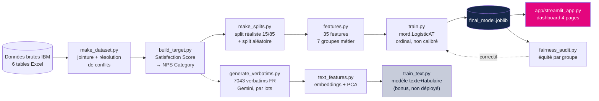
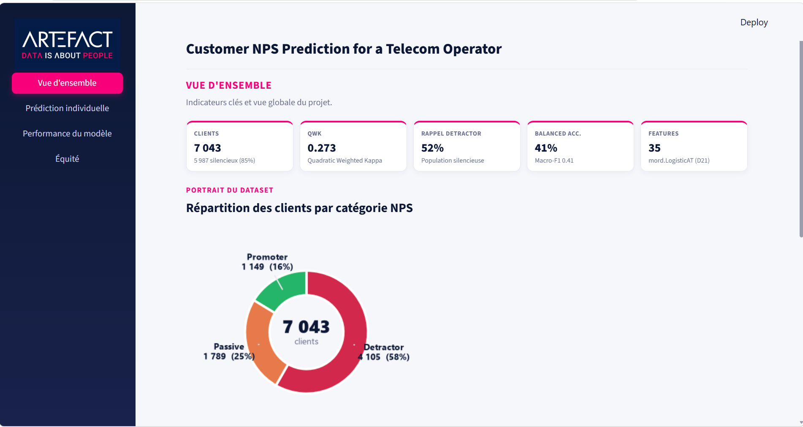
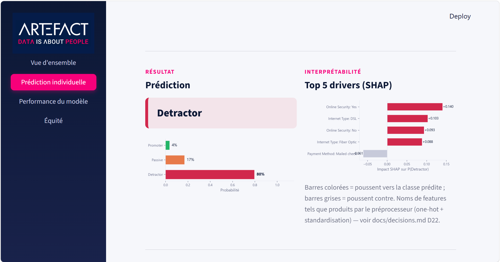
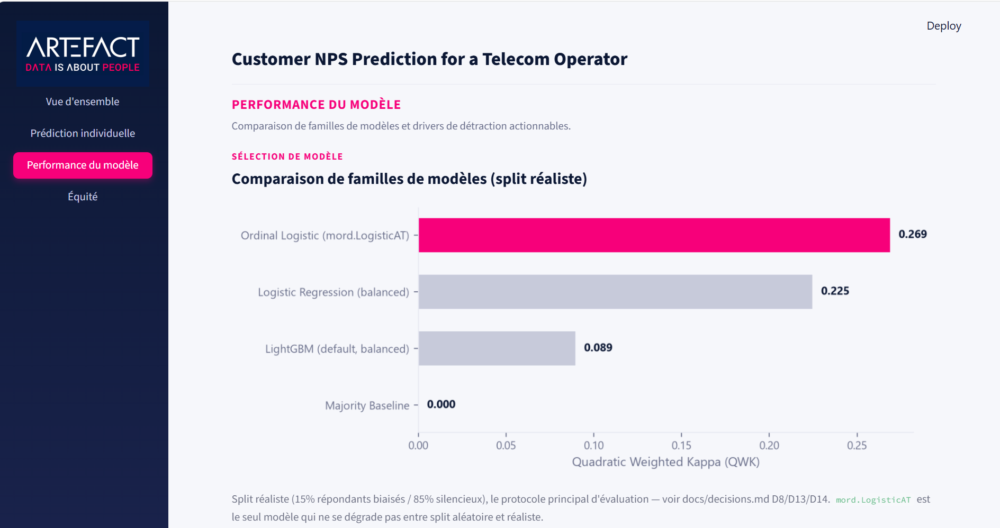
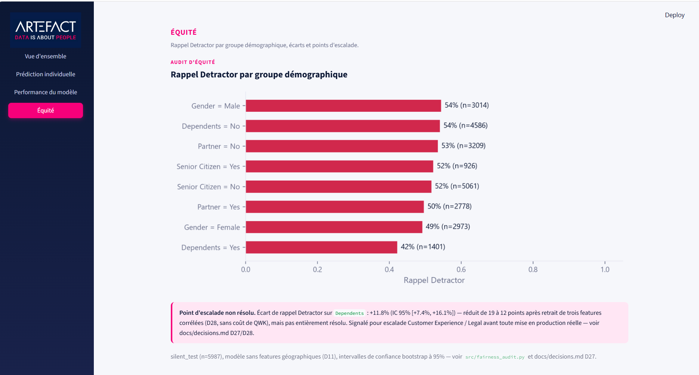

<div align="center">

# Prédiction NPS — Challenge Artefact
### *Customer NPS Prediction for a Telecom Operator*


Documentation complète du projet — du dataset brut IBM Telco jusqu'au
dashboard de prédiction, en passant par chaque décision de modélisation.

</div>

---

## Sommaire

- [Prédiction NPS — Challenge Artefact](#prédiction-nps--challenge-artefact)
    - [*Customer NPS Prediction for a Telecom Operator*](#customer-nps-prediction-for-a-telecom-operator)
  - [Sommaire](#sommaire)
  - [1. Vue d'ensemble](#1-vue-densemble)
    - [Le problème métier](#le-problème-métier)
    - [Source de données](#source-de-données)
    - [Ce que ce document couvre](#ce-que-ce-document-couvre)
  - [2. Architecture du projet](#2-architecture-du-projet)
    - [Arborescence du dépôt](#arborescence-du-dépôt)
  - [3. Installation, dépendances et exécution](#3-installation-dépendances-et-exécution)
    - [Prérequis](#prérequis)
    - [Dépendances (`requirements.txt`)](#dépendances-requirementstxt)
    - [Clés d'environnement (`.env`)](#clés-denvironnement-env)
    - [Exécution du pipeline complet (raw → prédiction)](#exécution-du-pipeline-complet-raw--prédiction)
    - [Lancer le dashboard](#lancer-le-dashboard)
    - [Évaluation complète et audits (au-delà de l'app)](#évaluation-complète-et-audits-au-delà-de-lapp)
    - [(Optionnel) Régénérer les verbatims synthétiques](#optionnel-régénérer-les-verbatims-synthétiques)
  - [4. Phase 1 — Construction du dataset](#4-phase-1--construction-du-dataset)
    - [4.1 Jointure des tables brutes (`src/make_dataset.py`)](#41-jointure-des-tables-brutes-srcmake_datasetpy)
    - [4.2 Construction de la cible NPS (`src/build_target.py`)](#42-construction-de-la-cible-nps-srcbuild_targetpy)
    - [4.3 Splits (`src/make_splits.py`)](#43-splits-srcmake_splitspy)
  - [5. Phase 2 — Feature engineering et évaluation](#5-phase-2--feature-engineering-et-évaluation)
    - [5.1 Features (`src/features.py`)](#51-features-srcfeaturespy)
    - [5.2 Évaluation (`src/evaluate.py`)](#52-évaluation-srcevaluatepy)
    - [5.3 Comparaison de modèles baseline (`notebooks/02_modeling.ipynb`)](#53-comparaison-de-modèles-baseline-notebooks02_modelingipynb)
  - [6. Phase 3 — Modélisation approfondie](#6-phase-3--modélisation-approfondie)
    - [Tuning LightGBM — améliore, ne rattrape pas](#tuning-lightgbm--améliore-ne-rattrape-pas)
    - [TabPFN (bonus) — bloqué](#tabpfn-bonus--bloqué)
    - [Calibration — testée, puis rejetée](#calibration--testée-puis-rejetée)
    - [Sensibilité au bruit de label](#sensibilité-au-bruit-de-label)
    - [Modèle final retenu](#modèle-final-retenu)
  - [7. Interprétabilité : SHAP et drivers de détraction](#7-interprétabilité--shap-et-drivers-de-détraction)
  - [8. Phase 4 — Verbatims synthétiques](#8-phase-4--verbatims-synthétiques)
    - [Ce qui était demandé](#ce-qui-était-demandé)
    - [Le pipeline final](#le-pipeline-final)
  - [9. Phase 4 — Audit d'équité](#9-phase-4--audit-déquité)
    - [La découverte](#la-découverte)
    - [Le correctif — et une erreur corrigée en cours de route](#le-correctif--et-une-erreur-corrigée-en-cours-de-route)
  - [10. Phase 4 — Signal texte (bonus)](#10-phase-4--signal-texte-bonus)
    - [Le résultat qui semblait spectaculaire](#le-résultat-qui-semblait-spectaculaire)
  - [11. Phase 5 — Dashboard Streamlit](#11-phase-5--dashboard-streamlit)
    - [Choix de design](#choix-de-design)
  - [12. Reproductibilité](#12-reproductibilité)
  - [13. Monitoring post-déploiement (proposition)](#13-monitoring-post-déploiement-proposition)
  - [14. Résultats clés — résumé](#14-résultats-clés--résumé)
  - [15. Limites connues, assumées et documentées](#15-limites-connues-assumées-et-documentées)
  - [16. Index des fichiers de référence](#16-index-des-fichiers-de-référence)
  - [17. Prochaines étapes](#17-prochaines-étapes)

---

## 1. Vue d'ensemble

### Le problème métier

Un opérateur télécom envoie des enquêtes de satisfaction (NPS) à ses
clients, mais **seuls 15% y répondent**. L'équipe rétention ne peut pas
prioriser ses actions sur les 85% restants faute de savoir qui est
mécontent. L'objectif de ce projet : prédire la catégorie NPS
(**Detractor / Passive / Promoter**) de n'importe quel client, y compris
— et surtout — ceux qui n'ont jamais répondu à l'enquête.

> [!IMPORTANT]
> Le protocole d'évaluation principal simule exactement ce scénario :
> le modèle est entraîné sur un sous-échantillon de 15% de "répondants"
> (avec un biais de réponse réaliste et documenté), puis évalué sur les
> 85% restants, jamais vus à l'entraînement. Un split aléatoire classique
> sert uniquement de point de comparaison — jamais de référence.

### Source de données

[IBM Telco Customer Churn v11.1.3+](https://www.kaggle.com/datasets/blastchar/telco-customer-churn)
(multi-tables), **pas** la version Kaggle "blastchar" à plat, qui ne
contient pas la colonne `Satisfaction Score` — la source de toute la
cible de ce projet.

### Ce que ce document couvre

Chaque étape du pipeline, du fichier brut jusqu'au dashboard, avec les
vrais chiffres obtenus (jamais inventés), les fichiers concernés, et un
renvoi vers la justification complète dans
[`docs/decisions.md`](docs/decisions.md) (38 décisions documentées au
format Décision / Alternatives / Justification / Impact).

---

## 2. Architecture du projet



### Arborescence du dépôt

```
Challenge_Artefact/
├── README.md                    Installation + pipeline en commandes numérotées
├── DOCUMENTATION.md              Ce fichier
├── requirements.txt
├── .env.example                  Gabarit des clés d'environnement
├── .streamlit/config.toml        Thème du dashboard (navy/magenta)
│
├── data/
│   ├── raw/                     6 tables IBM brutes (jamais modifiées)
│   ├── processed/                Dataset analytique + labels + splits (.parquet)
│   └── verbatims/                7043 verbatims synthétiques + prompt utilisé
│
├── src/
│   ├── config.py                 Chemins, seed=42, LEAKAGE_BLACKLIST, mapping du label
│   ├── make_dataset.py            Raw → dataset analytique
│   ├── build_target.py            Satisfaction Score → label NPS
│   ├── make_splits.py             Split réaliste 15/85 + split aléatoire
│   ├── features.py                 Feature engineering (35 features, 7 groupes)
│   ├── evaluate.py                 QWK, macro-F1, lift, calibration, bootstrap CI
│   ├── train.py                    Entraînement + persistance du modèle final
│   ├── fairness_audit.py           Audit d'équité par groupe démographique
│   ├── generate_verbatims.py       Génération de verbatims (Gemini/Anthropic/Groq)
│   ├── text_features.py            Embeddings sentence-transformers + PCA
│   └── train_text.py               Modèle texte+tabulaire (bonus, comparaison)
│
├── notebooks/
│   ├── 01_eda.ipynb                Analyse exploratoire
│   ├── 02_modeling.ipynb           Comparaison de modèles, tuning, bootstrap CI
│   └── 03_interpretation.ipynb     SHAP, analyse par segments
│
├── models/                        Artefacts entraînés (.joblib, non versionnés)
├── app/
│   ├── streamlit_app.py            Dashboard 4 pages (Vue d'ensemble, Prédiction, Performance, Équité)
│   └── assets/logo.png             Logo Artefact (fourni par l'utilisateur)
│
├── docs/
│   ├── decisions.md                 Journal de décisions complet (38 entrées)
│   ├── monitoring_proposal.md       Proposition de monitoring post-déploiement
│   ├── writeup_fr.docx               Write-up final (Word, identité visuelle Artefact, captures incluses)
│   └── screenshots/                  Captures d'écran du dashboard
│
└── reports/figures/                 SHAP, matrices de confusion, courbes de lift/calibration
```

---

## 3. Installation, dépendances et exécution

### Prérequis

| | |
|---|---|
| Python | 3.11+ (développé et testé avec 3.13.14) |
| OS | Windows / macOS / Linux (commandes documentées en PowerShell) |
| Espace disque | ~2 Go (dépendances ML incluses) |
| Connexion internet | Requise une fois (téléchargement des modèles sentence-transformers, packages) |

### Dépendances (`requirements.txt`)

| Catégorie | Packages | Rôle |
|---|---|---|
| Cœur data science | `pandas`, `numpy`, `pyarrow`, `openpyxl` | Manipulation des données, lecture Excel/Parquet |
| Modélisation | `scikit-learn`, `lightgbm`, `mord` | Pipelines, gradient boosting, régression ordinale |
| Foundation model (bonus) | `tabpfn` | Tentative bloquée par licence — voir [§6](#tabpfn-bonus-bloqué) |
| Interprétabilité | `shap` | Valeurs SHAP (méthode model-agnostic) |
| Texte | `sentence-transformers`, `pydantic` | Embeddings des verbatims + schéma structuré Gemini |
| LLM (verbatims) | `google-genai`, `anthropic`, `groq` | Génération de texte (Gemini par défaut, alternatives) |
| App | `streamlit`, `matplotlib` | Dashboard + visualisations |
| Config | `python-dotenv` | Chargement du `.env` |
| Notebooks | `jupyter`, `nbconvert`, `nbclient` | Exécution des notebooks |

Installation complète :

```powershell
python -m venv .venv
.venv\Scripts\activate
pip install -r requirements.txt
```

### Clés d'environnement (`.env`)

> [!WARNING]
> Aucune clé n'est codée en dur nulle part dans le dépôt. `.env` est
> listé dans `.gitignore` (première ligne). Ne jamais commiter ce
> fichier — toujours partir de `.env.example`.

```powershell
Copy-Item .env.example .env      # bash/macOS/Linux : cp .env.example .env
```

| Variable | Obligatoire pour | Où l'obtenir |
|---|---|---|
| `VERBATIM_PROVIDER` | Choix du fournisseur LLM (`gemini` par défaut) | — (valeur `gemini`, `anthropic` ou `groq`) |
| `GEMINI_API_KEY` | Régénérer les verbatims (fournisseur par défaut) | [aistudio.google.com/apikey](https://aistudio.google.com/apikey) |
| `ANTHROPIC_API_KEY` | Si `VERBATIM_PROVIDER=anthropic` | [console.anthropic.com](https://console.anthropic.com) |
| `GROQ_API_KEY` | Si `VERBATIM_PROVIDER=groq` (validation gratuite) | [console.groq.com](https://console.groq.com) |

**Aucune clé n'est nécessaire** pour reproduire le pipeline principal
(raw → prédiction) : `data/verbatims/verbatims.csv` (7043 lignes) est
déjà fourni dans le dépôt. Les clés ne servent qu'à **régénérer** les
verbatims soi-même.

> [!NOTE]
> **Windows uniquement** : l'installation du paquet `jupyter` complet
> peut échouer avec une erreur `OSError` sur un fichier
> `jupyterlab\galata\...` si le support des chemins longs (MAX_PATH)
> n'est pas activé côté Windows. Cela n'empêche pas
> `nbconvert`/`nbclient`/`ipykernel` (les paquets réellement utilisés
> pour exécuter les notebooks en ligne de commande) de s'installer
> correctement — l'erreur ne bloque que `jupyterlab` lui-même, inutile
> si vous n'ouvrez pas son interface. Pour activer les chemins longs :
> [pip.pypa.io/warnings/enable-long-paths](https://pip.pypa.io/warnings/enable-long-paths).

### Exécution du pipeline complet (raw → prédiction)

Toutes les commandes s'exécutent **depuis la racine du projet**,
environnement virtuel activé. Chaque script est déterministe (seed 42
partout, `src/config.py:SEED`) : ré-exécuter produit des artefacts
strictement identiques.

```powershell
# 1. Raw -> dataset analytique (jointure des 6 tables IBM, résolution des
#    conflits de colonnes, gestion du Total Charges vide à tenure=0)
python src/make_dataset.py
# -> data/processed/analytical_dataset.parquet

# 2. Dataset analytique -> label NPS (Satisfaction Score -> Detractor/
#    Passive/Promoter, + variante bruitée pour le test de sensibilité)
python src/build_target.py
# -> data/processed/labeled_dataset.parquet

# 3. Construction des splits : réaliste (15% répondants biaisés / 85%
#    silencieux, protocole principal) + aléatoire stratifié (comparaison
#    seulement)
python src/make_splits.py
# -> data/processed/split_realistic.parquet, split_random.parquet

# 4. Entraînement et persistance du modèle final (mord.LogisticAT
#    ordinal, class-balanced, non calibré — voir D19/D21)
python -c "import sys; sys.path.insert(0, 'src'); from train import main; main()"
# -> models/final_model.joblib
```

> [!WARNING]
> Ne **pas** lancer `python src/train.py` directement : cela enregistre
> la classe `OrdinalLogisticClassifier` sous le module `__main__`, et
> l'artefact ne pourra plus être rechargé par un autre script
> (`AttributeError` au `joblib.load`). L'invocation par import
> ci-dessus évite ce piège.

### Lancer le dashboard

```powershell
streamlit run app/streamlit_app.py
# si `streamlit` n'est pas reconnu comme commande :
python -m streamlit run app/streamlit_app.py
```

Ouvre l'app dans le navigateur (http://localhost:8501) — voir
[§11](#11-phase-5--dashboard-streamlit) pour le détail des 4 pages.
Toutes les métriques affichées sont recalculées en direct à chaque
chargement (jamais copiées en dur, D32) et le cache se rafraîchit
automatiquement si les fichiers sous-jacents changent (D33).

### Évaluation complète et audits (au-delà de l'app)

Le protocole complet de comparaison de modèles (4 modèles × 2 splits,
bootstrap CI, tuning LightGBM, TabPFN) et l'interprétation SHAP +
l'audit de segments sont dans les notebooks :

```powershell
jupyter notebook notebooks/02_modeling.ipynb
jupyter notebook notebooks/03_interpretation.ipynb
```

L'audit d'équité par groupe démographique se lance séparément et
régénère `reports/fairness_audit*.csv` + les figures associées :

```powershell
python src/fairness_audit.py
```

### (Optionnel) Régénérer les verbatims synthétiques

Non nécessaire pour reproduire le pipeline raw → prédiction —
`data/verbatims/verbatims.csv` est déjà fourni. À ne relancer que pour
régénérer les verbatims soi-même (coût API, `GEMINI_API_KEY` requise) :

```powershell
python -c "import sys; sys.path.insert(0, 'src'); import pandas as pd; import config; from generate_verbatims import build_verbatim_plan, run_full_generation_gemini; labeled = pd.read_parquet(config.LABELED_DATASET_PATH); plan = build_verbatim_plan(labeled); run_full_generation_gemini(labeled, plan)"
```

---

## 4. Phase 1 — Construction du dataset

### 4.1 Jointure des tables brutes (`src/make_dataset.py`)

Six tables IBM sont chargées et jointes sur `Customer ID` (+ `Zip Code`
pour la table population). La table `Telco_customer_churn.xlsx` sert de
**table canonique** : c'est la seule où le quirk documenté par le
challenge ("Total Charges vide quand tenure=0") existe réellement.

> [!NOTE]
> **Décision D2** — chaque conflit de colonnes entre tables a été
> vérifié explicitement (taux de correspondance calculé), jamais résolu
> silencieusement par un "dernier merge gagne". Exemple : `location.xlsx`
> n'est **pas** fusionnée car elle ne s'accorde qu'à 96.3% avec la table
> de base sur `City`/`Zip Code`/`Latitude`/`Longitude`.

- **11 clients** avaient `Total Charges` vide à `Tenure Months == 0` →
  remplis par `0.0` (nouveaux clients jamais facturés, pas une donnée
  manquante au sens strict) — D3.
- Colonnes constantes (`Count`, `Country`, `State`) supprimées — D4.
- **Résultat : 7043 clients, 49 colonnes** → `data/processed/analytical_dataset.parquet`

### 4.2 Construction de la cible NPS (`src/build_target.py`)

| Satisfaction Score | Catégorie NPS |
|---|---|
| 5 | Promoter |
| 4 | Passive |
| 1, 2, 3 | Detractor |

> [!CAUTION]
> **`LEAKAGE_BLACKLIST`** (`src/config.py`) — ces colonnes ne doivent
> **jamais** entrer dans les features : `Churn Score`, `Churn Value`,
> `Churn Label`, `Churn Reason`, `Churn Category`, `Customer Status`,
> `CLTV`, `Satisfaction Score` (la source du label lui-même). Vérifié
> automatiquement par `features.assert_no_leakage()` à chaque appel —
> toute réintroduction accidentelle lève une exception immédiatement.

**Distribution obtenue** (7043 clients) :

| Detractor | Passive | Promoter |
|---|---|---|
| 4 105 (58.3%) | 1 789 (25.4%) | 1 149 (16.3%) |

Une **variante bruitée** de la cible (`NPS Category Noisy`) réassigne
~10% des lignes à une classe ordinale **adjacente** (jamais un saut de
deux crans), pour un test de sensibilité au bruit de label (D7,
utilisé en [§6](#sensibilité-au-bruit-de-label)).

### 4.3 Splits (`src/make_splits.py`)

| Split | Description | Taille |
|---|---|---|
| **Réaliste** (protocole principal) | 15% "répondants" (propension biaisée vers faible satisfaction + forte ancienneté) / 85% "silencieux" | 1 056 / 5 987 |
| **Aléatoire** (comparaison seulement) | Stratifié classique 70/30 | 4 930 / 2 113 |

> [!IMPORTANT]
> Le split réaliste n'est **pas** représentatif par construction — c'est
> le but. Les répondants sont 80.3% Detractor (vs 58.3% globalement),
> satisfaction moyenne 2.60 vs 3.24, ancienneté moyenne 46.6 vs 32.4
> mois. Un modèle entraîné là-dessus doit généraliser à une population
> globalement bien plus équilibrée — c'est exactement le défi que ce
> protocole est conçu pour révéler (D8).

---

## 5. Phase 2 — Feature engineering et évaluation

### 5.1 Features (`src/features.py`)

**35 features** (après [D28](#audit-déquité--d27-d28), 20 catégorielles
+ 15 numériques), organisées en 7 groupes métier :

| Groupe | Exemples |
|---|---|
| `tenure` | Ancienneté, bucket d'ancienneté |
| `contract_billing` | Contrat, paiement automatique, facturation dématérialisée |
| `charges` | Charges mensuelles/totales, charges par service |
| `services` | Bundles streaming/sécurité, nombre de services actifs |
| `engagement` | Parrainages, offre promotionnelle |
| `household` | Genre, senior citizen, partner, âge, under 30 |
| `geo_features` | Latitude/longitude/population — **désactivé par défaut** |

> [!NOTE]
> Les features géographiques existent dans le code (`include_geo=True`)
> mais sont désactivées par défaut : ce sont des proxys de statut
> socio-économique (brief section 4.7). Confirmé plus tard par l'audit
> d'équité qu'elles n'apportent **aucun** gain de performance
> (QWK légèrement pire avec, 0.270 vs 0.273) — aucun arbitrage réel à
> faire, elles restent exclues (D11, D27).
>
> `Zip Code` et `City` ne sont **jamais** utilisées comme features, sous
> aucune configuration — proxys trop directs, exclus dès la conception.

### 5.2 Évaluation (`src/evaluate.py`)

**L'accuracy seule est interdite** comme critère de décision (règle du
challenge). Métriques calculées systématiquement :

- **QWK** (Quadratic Weighted Kappa) — métrique principale, pénalise les
  erreurs ordinales lointaines plus que les erreurs adjacentes
- Macro-F1, balanced accuracy, rappel par classe
- Lift cumulatif sur la classe Detractor (par décile)
- Courbes de calibration (ECE — Expected Calibration Error)
- Intervalles de confiance bootstrap (2000 ré-échantillonnages)

### 5.3 Comparaison de modèles baseline (`notebooks/02_modeling.ipynb`)

Quatre familles comparées sur les deux splits :

| Split | Modèle | QWK | Rappel Detractor |
|---|---|---|---|
| **Réaliste** | **Ordinal Logistic (mord.LogisticAT)** | **0.269** [0.244, 0.293] | 0.517 |
| Réaliste | Logistic Regression | 0.225 | 0.619 |
| Réaliste | LightGBM (défaut) | 0.089 | 0.909 |
| Réaliste | Baseline majoritaire | 0.000 | 1.000 |
| Aléatoire | Logistic Regression | 0.300 | 0.498 |
| Aléatoire | LightGBM (défaut) | 0.270 | 0.594 |
| Aléatoire | Ordinal Logistic | 0.259 | 0.349 |

> [!WARNING]
> **La découverte la plus importante de cette phase** : LightGBM est
> compétitif sur le split aléatoire (QWK 0.270) mais **s'effondre**
> sur le split réaliste (QWK 0.089) — il sur-apprend le petit
> échantillon biaisé de 1056 répondants et prédit "Detractor" pour 91%
> des clients silencieux. `mord.LogisticAT` est le **seul** modèle qui
> ne se dégrade pas entre les deux splits — sa structure ordinale + sa
> capacité limitée agissent comme une régularisation naturelle (D13/D14).
> Un choix basé uniquement sur le split aléatoire aurait sélectionné le
> pire modèle en production.

---

## 6. Phase 3 — Modélisation approfondie

### Tuning LightGBM — améliore, ne rattrape pas

| Variante | QWK (split réaliste) |
|---|---|
| Défaut | 0.089 |
| Tuning 1 (grid search bornée) | 0.193 |
| Tuning 2 (~20 essais ciblés) | 0.224 |
| Régression + seuils optimisés | 0.210 |
| **mord.LogisticAT (référence)** | **0.269** |

Même fortement régularisé, LightGBM ne dépasse jamais `mord.LogisticAT`
(différence appariée par bootstrap toujours positive, D17/D18).

### TabPFN (bonus) — bloqué

> [!NOTE]
> Installation réussie, mais `TabPFNClassifier` exige une acceptation de
> licence interactive (compte PriorLabs.ai + `TABPFN_TOKEN`) — impossible
> à automatiser. Documenté honnêtement comme blocage plutôt que contourné
> silencieusement (D18b). Le jeu d'entraînement (1056 lignes, 78 colonnes
> encodées, 3 classes) est dans les limites documentées de TabPFN v2 —
> prêt à tester si un compte est créé.

### Calibration — testée, puis rejetée

> [!CAUTION]
> **Résultat le plus contre-intuitif du projet.** L'ECE non calibré
> (0.08–0.15 selon la classe) dépassait le seuil de 0.05 qui justifie
> normalement une recalibration. La validation croisée *anti-fuite*
> (jamais sur `silent_test`) confirmait que `sigmoid` améliorait l'ECE.
> **Mais une fois appliqué sur `silent_test` : le modèle calibré
> s'effondre totalement** — QWK = 0.000, il prédit "Detractor" pour
> 100% des clients.
>
> **Pourquoi** : la calibration apprend à recaler les probabilités sur
> la fréquence *observée dans l'échantillon d'entraînement* — biaisé à
> 80.3% Detractor (D8). "Anti-fuite" et "représentatif de la population
> cible" sont deux garanties différentes ; ici seule la seconde compte.
> **Décision : le modèle final n'est pas calibré** (D19).

### Sensibilité au bruit de label

Entraîner sur la cible bruitée (D7) plutôt que la cible propre coûte
**~23% de QWK relatif** (0.269 → 0.207) — un coût réel, pas du bruit
(IC bootstrap entièrement positif). La stabilité du classement des
features sous bruit n'est que modérée (corrélation de rang de Spearman
= 0.687) — à garder en tête en lisant les drivers SHAP ci-dessous (D20).

### Modèle final retenu

**`mord.LogisticAT`** (`alpha=1.0`, poids équilibrés par classe), non
calibré, entraîné sur `respondent_train`. Seul modèle stable entre les
deux splits, structure ordinale nativement interprétable (D21).

---

## 7. Interprétabilité : SHAP et drivers de détraction

`mord.LogisticAT` est un modèle linéaire ordinal, pas un arbre —
`shap.TreeExplainer` ne s'applique pas. SHAP est calculé en mode
model-agnostic (`shap.Explainer` / Permutation) sur l'espace **transformé**
(après `StandardScaler` + `OneHotEncoder`), la seule approche robuste
pour un modèle non-arbre sur données mixtes (D22).

<p align="center">
  
</p>

**Même trio de drivers domine dans presque tous les segments testés**
(ancienneté, type de contrat, type d'accès internet) :

| Driver | Actionnable ? | Levier |
|---|---|---|
| `Monthly Charges` | Oui | Remise de rétention ciblée pour charge élevée relative au segment |
| `Internet Type` (Fibre) | Partiellement | Infrastructure fixe, mais le grief sous-jacent (qualité/prix) est actionnable |
| `Online Security` (absent) | Oui | Bundling proactif plutôt qu'attendre une souscription spontanée |
| Contrat mensuel | Oui | Incitation à la montée vers un contrat annuel |
| Ancienneté | Non directement | Onboarding renforcé pour les nouveaux clients à risque |

<p align="center">
  
</p>
<p align="center">
  
</p>

> [!NOTE]
> Aucune variable démographique (genre, senior citizen, partner,
> dependents) n'apparaît dans le top 5 SHAP d'aucun segment testé — un
> signal préliminaire *encourageant mais insuffisant*, largement
> contredit ensuite par l'audit d'équité direct ([§9](#9-phase-4--audit-déquité)). SHAP mesure une
> association apprise, jamais une causalité (D23).

---

## 8. Phase 4 — Verbatims synthétiques

### Ce qui était demandé

Un verbatim ("dernière note d'interaction") synthétique par client,
généré par LLM, réaliste en ton (Detractor frustré, Promoter enthousiaste)
mais avec une corrélation **imparfaite** au label (~15-20% de cas
discordants), reproductible.

### Le pipeline final

- **Fournisseur : Google Gemini** (`gemini-3.1-flash-lite`), après une
  validation gratuite via Groq (`llama-3.1-8b-instant`, 1359 verbatims,
  conservés dans `data/verbatims/verbatims_groq_pilot_run.csv`).
- **Génération en français**, par lots de 25 clients par appel API
  (`generate_verbatims.run_full_generation_gemini`).
- **17.5%** des verbatims délibérément "discordants" (ton qui contredit
  le vrai label).

> [!WARNING]
> **Deux vrais blocages rencontrés et documentés, pas contournés
> silencieusement :**
> 1. `gemini-3.5-flash` (choix initial) a un quota gratuit réel de
>    **20 requêtes/jour** sur le compte utilisé — découvert après 9 lots
>    seulement. Recherche web initiale trouvait "~1500 RPD" pour
>    "Gemini Flash" en général — ce chiffre ne s'appliquait pas à ce
>    modèle précis sur ce compte précis.
> 2. Bascule vers `gemini-3.1-flash-lite` (quota séparé, 1000 RPD,
>    qualité de texte équivalente vérifiée) — **282 lots, 7043/7043
>    clients, zéro échec**, ~41 minutes (D29/D30).

**Vérifications sur le fichier final** (`data/verbatims/verbatims.csv`) :
7043 lignes, 7043 ID uniques, 0 verbatim vide, distribution NPS
identique au dataset labellisé, taux discordant 18.1% (cible 17.5%).

---

## 9. Phase 4 — Audit d'équité

### La découverte

`src/fairness_audit.py` compare le rappel Detractor par groupe
démographique sur `silent_test`, avec intervalles de confiance bootstrap :

<p align="center">
  
</p>

| Groupe | Écart de rappel | Robuste ? |
|---|---|---|
| Senior Citizen | −0.1 pt | Non — IC contient 0 |
| Gender (F vs M) | −6.3 pts | Oui, non traité |
| **Dependents (Non vs Oui)** | **+19.2 pts** | **Oui, large** |

> [!CAUTION]
> **55% de rappel Detractor pour les clients sans personne à charge,
> contre seulement 36% pour ceux qui en ont.** Exactement le type de
> disparité que le brief cite en exemple comme inacceptable — testé
> directement, pas juste supposé absent parce qu'aucune variable
> démographique n'apparaissait dans le top 5 SHAP (D27).

### Le correctif — et une erreur corrigée en cours de route

Retirer `Dependents`/`Number of Dependents` seuls change à peine l'écart
(19.2 → 18.9 pts) : une feature dérivée, `Household Size Proxy`
(= 1 + Partner + Number of Dependents), réencodait la même information
sous un autre nom. **Retirer les trois ensemble** :

| | Avant | Après |
|---|---|---|
| QWK | 0.269 | **0.273** *(mouvement dans le bruit, pas un gain revendiqué)* |
| Écart `Dependents` | +19.2 pts | **+11.8 pts** |

**Aucun coût de performance, gain d'équité réel — mais partiel.**
L'écart résiduel de 12 points **n'est pas résolu** et reste un point
d'escalade explicite vers les équipes Customer Experience / Legal avant
toute mise en production (D27/D28). `models/final_model.joblib` compte
désormais **35 features** (au lieu de 38).

---

## 10. Phase 4 — Signal texte (bonus)

### Le résultat qui semblait spectaculaire

`src/text_features.py` (embeddings `paraphrase-multilingual-MiniLM-L12-v2`
+ PCA à 20 composantes) + `src/train_text.py` (concaténation aux features
tabulaires) donnent :

<div align="center">

**QWK 0.273 → 0.875**

</div>

> [!CAUTION]
> **Ce chiffre n'est pas fiable, et ce document ne le présente pas comme
> une victoire.** Les verbatims ont été générés en donnant au LLM le
> vrai label du client *avant* qu'il écrive le texte. Un modèle qui lit
> le ton du texte est donc proche de relire le label dans sa propre
> reformulation.

**Test de robustesse** : comparaison sur le sous-ensemble discordant
(ton du texte qui contredit délibérément le vrai label) :

| Sous-ensemble | QWK texte+tabulaire | QWK tabulaire seul | Écart |
|---|---|---|---|
| Non-discordant (82%) | 0.906 | 0.273 | +0.634 |
| **Discordant (18%)** | **0.736** | 0.273 | **+0.463** |

L'écart se réduit fortement (preuve de fuite via le ton) mais **ne
disparaît pas** (preuve que le texte redérive aussi des faits déjà
présents dans les données tabulaires). **Conclusion honnête : cette
expérience ne peut pas mesurer ce qu'un vrai verbatim client
indépendant apporterait** — seulement que nos verbatims synthétiques
sont, par construction, trop informatifs pour qu'on leur fasse confiance
(D31).

`models/final_model_text.joblib` existe, est reproductible, mais
**n'est pas déployé** — ni recommandé en production, ni branché aux
prédictions live du dashboard.

---

## 11. Phase 5 — Dashboard Streamlit

Quatre pages, navigation en barre latérale :

| Page | Contenu |
|---|---|
| **Vue d'ensemble** | KPIs live, répartition NPS (donut), points clés |
| **Prédiction individuelle** | Client existant ou saisie manuelle, catégorie + probabilités + top 5 SHAP, bonus verbatim |
| **Performance du modèle** | Comparaison de familles de modèles, drivers actionnables |
| **Équité** | Rappel Detractor par groupe, écart résiduel signalé dans l'UI |

<p align="center">
  
  <br><em>Page Vue d'ensemble — KPIs et donut NPS</em>
</p>
<p align="center">
  
  <br><em>Page Prédiction, avec drivers SHAP</em>
</p>
<p align="center">
  
  <br><em>Page Performance — comparaison de familles de modèles</em>
</p>
<p align="center">
  
  <br><em>Page Équité — rappel Detractor par groupe et écart signalé</em>
</p>

Captures complètes (8 au total, dont ces 4) : voir
[`docs/screenshots/README.md`](docs/screenshots/README.md) et la
Section 9 de [`docs/writeup_fr.md`](docs/writeup_fr.md), qui les intègre
toutes avec une légende expliquant chaque composant de l'interface.

### Choix de design

- **Toutes les métriques affichées sont calculées en direct**, jamais
  copiées en dur — `compute_headline_metrics()` évalue réellement
  `final_model.joblib` sur `silent_test` à chaque chargement (D32).
- **Cache correctement invalidé** : chaque fonction mise en cache est
  déclenchée par la date de modification du fichier source concerné
  (`_file_signature()`) — un ré-entraînement du modèle ou un nouveau run
  de `fairness_audit.py` se reflète dès la page suivante, sans
  redémarrer le serveur (D33, corrige un bug réel de mise en cache
  découvert et prouvé empiriquement en cours de session).
- Palette navy/magenta assortie au brief Artefact, aucune donnée
  encodée par la couleur seule (toujours accompagnée d'une valeur
  chiffrée), invalidité de saisie empêchée par construction (champs
  dépendants masqués plutôt que validés après coup) — D25/D32.
- Panneau bonus verbatim honnête plutôt que fonctionnel-mais-trompeur —
  voir [§10](#10-phase-4--signal-texte-bonus).

Lancement :

```powershell
streamlit run app/streamlit_app.py
```

---

## 12. Reproductibilité

- **Seed globale = 42** partout (`src/config.py:SEED`) — numpy,
  scikit-learn, tirage du split réaliste, sélection des verbatims
  discordants.
- Chaque script `src/*.py` est déterministe, ré-exécutable sans
  changer les artefacts produits.
- **Vérifié dans un environnement totalement vierge** (venv neuf,
  chemin court pour éviter la limite Windows MAX_PATH) : les 4 scripts
  du pipeline + l'app reproduisent des chiffres strictement identiques.
- Pipeline complet en commandes numérotées : voir [`README.md`](README.md).

---

## 13. Monitoring post-déploiement (proposition)

Détail complet dans [`docs/monitoring_proposal.md`](docs/monitoring_proposal.md)
— proposition uniquement, non implémentée (brief section 4.9, optionnelle).

- **Drift des inputs** — PSI (Population Stability Index), référence =
  population réellement scorée (`silent_test`), pas `respondent_train`
  (biaisé par construction, D8) pour ne pas confondre drift réel et
  biais de réponse déjà connu.
- **Drift des prédictions** — distribution des classes prédites suivie
  dans le temps, en complément du PSI des inputs.
- **Évaluation continue** — dès que de nouvelles réponses à l'enquête
  arrivent, calcul du QWK réel glissant, comparé à l'IC de déploiement.
- **Trigger de ré-entraînement** — combinaison : calendrier (6 mois),
  PSI > 0.25 deux semaines consécutives, QWK glissant sous la borne
  basse de l'IC, minimum 1000 nouveaux labels.
- **Boucle de feedback** — les actions de rétention elles-mêmes
  modifient la distribution future (customer performatif) : proposition
  de groupe de contrôle randomisé pour ne pas contaminer les futurs
  jeux d'entraînement.

---

## 14. Résultats clés — résumé

<div align="center">

| Indicateur | Valeur |
|---|---|
| Clients totaux | 7 043 |
| Population silencieuse (déploiement cible) | 5 987 (85%) |
| **QWK (modèle final, silent_test)** | **0.273** |
| Balanced accuracy | 0.41 |
| Rappel Detractor | 0.52 |
| Features du modèle | 35 |
| Verbatims synthétiques générés | 7 043 / 7 043 |
| Écart d'équité résiduel (`Dependents`) | +12 pts *(escalade requise)* |
| Gain QWK du signal texte | Non fiable — voir [§10](#10-phase-4--signal-texte-bonus) |

</div>

---

## 15. Limites connues, assumées et documentées

- Écarts d'équité sur `Gender` (5 pts) et le résiduel sur `Dependents`
  (12 pts) **non résolus** — signalés pour décision métier, pas
  masqués par un correctif supplémentaire.
- Un seul tirage de l'échantillon "répondants" testé — les IC bootstrap
  capturent le bruit du test set, pas la variance d'un autre tirage de
  15% de répondants.
- Signal texte non évaluable de façon fiable avec des verbatims
  synthétiques générés à partir du label ([§10](#10-phase-4--signal-texte-bonus)).
- TabPFN non évalué (blocage de licence, [§6](#tabpfn-bonus--bloqué)).
- Les figures SHAP de `notebooks/03_interpretation.ipynb` ont été
  ré-exécutées après le correctif D28 (35 features) ; `notebooks/02_modeling.ipynb`
  ne l'a pas été dans son intégralité (coût de calcul non justifié pour
  un écart de QWK de 0.004) — une note explique ce choix dans le
  notebook lui-même.

---

## 16. Index des fichiers de référence

| Fichier | Contenu |
|---|---|
| [`README.md`](README.md) | Point d'entrée : installation + démarrage rapide, renvoie ici pour le détail |
| [`docs/decisions.md`](docs/decisions.md) | **38 décisions documentées** (Décision/Alternatives/Justification/Impact) |
| [`docs/writeup_fr.docx`](docs/writeup_fr.docx) | **Write-up officiel** (Word, identité visuelle Artefact — logo, navy `#002245`, magenta `#FF0066`, captures d'écran incluses) |
| [`docs/monitoring_proposal.md`](docs/monitoring_proposal.md) | Proposition de monitoring post-déploiement |
| [`notebooks/01_eda.ipynb`](notebooks/01_eda.ipynb) | Analyse exploratoire |
| [`notebooks/02_modeling.ipynb`](notebooks/02_modeling.ipynb) | Comparaison de modèles, tuning |
| [`notebooks/03_interpretation.ipynb`](notebooks/03_interpretation.ipynb) | SHAP, segments |
| [`src/config.py`](src/config.py) | Constantes, seed, liste noire de fuite |

---

## 17. Prochaines étapes

1. Si de vrais verbatims clients (non conditionnés par le label)
   deviennent disponibles, rejouer `text_features.py` + `train_text.py`
   dessus, avec le test par sous-ensemble discordant comme méthode de
   validation.
2. Investiguer les écarts `Gender`/`Dependents` résiduels avec les
   équipes Customer Experience avant toute mise en production réelle.
3. Ré-exécuter `notebooks/02_modeling.ipynb` intégralement contre le
   jeu de features à 35 colonnes pour aligner les chiffres imprimés.
4. Implémenter le monitoring proposé (§13) si le projet avance vers la
   production.

---

<div align="center">

*Chaque chiffre cité dans ce document provient d'une exécution réelle —
jamais une estimation ou une projection.*

</div>
